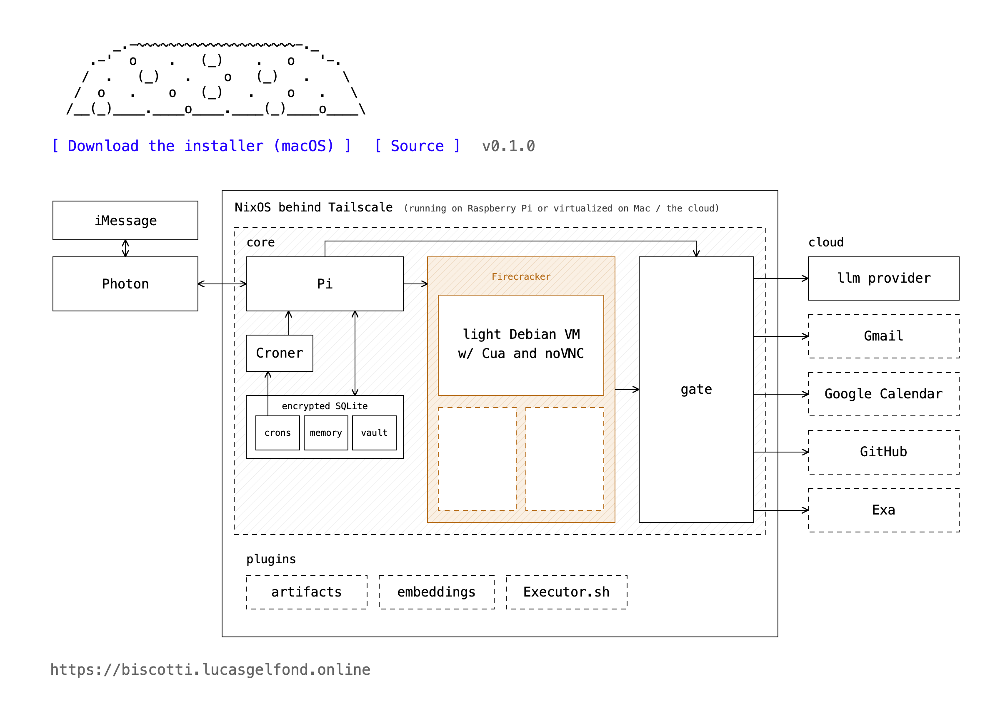
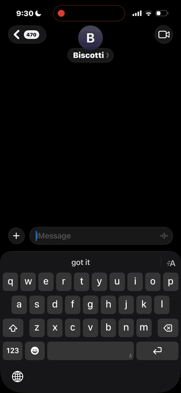
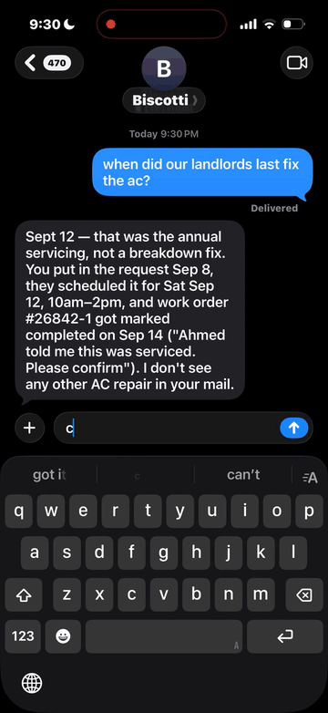
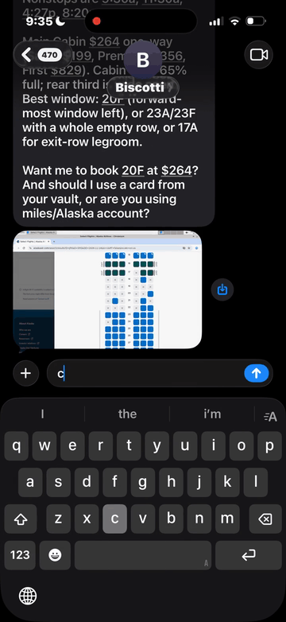

Biscotti is a self-hosted, lightweight iMessage agent. It takes a lot of inspiration from Instinct, which I loved but spooked me re perms and privacy.

I kept seeing more and more of the agent primitives (Pi harness, VM sandboxes in Firecracker, etc) open-sourced or widely available (i.e. Photon for iMessage) and figured I wouldn't need that much code to build something usable. This came together in a weekend and I'm daily driving it on my Raspberry Pi. I wanted to main as little surface area as possible so most things are plugins and it is easy to extend. 

The general design is a main Pi agent that dispatches tasks to little VMs. Access to outside connectors goes through a light permission layer, we handle memory / secrets / crons in SQLite. This is easily extensible to more connectors i.e. using something like [Executor](https://executor.sh/) or other off-the-shelf/community plugins. 

I built a small setup wizard that should make it easy to deploy on Raspberry Pi, Mac (with nested virutalization because it needs KVM access), or on AWS. Open for PRs + feedback! 

Acknowledgements: Shoutout to [Diego Rodriguez](https://www.diego.computer/) for thoughts about Instinct architecture / personal agents

The VM desktop uses [Cua](https://github.com/trycua/cua)'s XFCE scripts and `cua-spacesd` for computer control. Their licenses and notices are preserved in the image under `/usr/share/licenses/cua-xfce/` and `/usr/share/licenses/cua-spacesd/`.

<table><tr>
<td> Email</td>
<td> Flights / Computer Use</td>
<td> Reminders and recurring jobs</td>
</tr></table>

